# İş Makinesi Kira Ücreti Hesaplayıcı

C# konsol programı (.NET 8). Seçilen makine sınıfı, gün sayısı ve sezona göre toplam kira ücretini hesaplar.

> Bu depo bir pratik projesidir.

## Kapsam

**Kapsamda**
- Makine sınıfı, gün sayısı ve sezon girişi
- Girdi doğrulama (hatalı girişte soru tekrarlanır)
- Ücret hesabı ve sonucun yazdırılması
- "Yeni hesap? (E/H)" döngüsü

**Kapsam dışı**
- Veritabanı ve dosyaya kayıt
- Müşteri, şantiye ve plaka bilgisi
- Operatör, nakliye ve yakıt ücreti
- Uzun kiralama indirimi (ileride ek kural olarak eklenebilir)

## Girdiler

| Girdi | Tür | Geçerli değer |
|---|---|---|
| Makine sınıfı | menü numarası | 1, 2, 3 |
| Gün sayısı | tam sayı | 1–30 |
| Sezon | menü numarası | 1, 2, 3 |
| Yeni hesap | harf | E / H |

## İş kuralları

Oranlar kodun içine gömülmez, `Dictionary` içinde tutulur.

| Makine sınıfı | Günlük ücret |
|---|---|
| Mini ekskavatör | 1.000 TL |
| Kazıcı yükleyici | 1.500 TL |
| Paletli ekskavatör | 3.000 TL |

| Sezon | Katsayı |
|---|---|
| Kış | 0,8 |
| Bahar-Güz | 1,0 |
| Yaz | 1,3 |

**Formül:** `toplam = günlük ücret × gün sayısı × sezon katsayısı`

**Örnek:** Kazıcı yükleyici, 5 gün, Yaz → 1.500 × 5 × 1,3 = 9.750,00 TL

## Teknik kararlar

- Para hesabında `decimal` kullanılır (`double` kuruşta yuvarlama hatası yapabilir).
- Sayı girişleri `int.TryParse` ile alınır; hatalı girişte program çökmez.
- Kurallar `Dictionary` içinde tutulur; oran değişince yalnızca orası güncellenir.

## Plan

```mermaid
gantt
    title Geliştirme planı (yaklaşık 120 dk)
    dateFormat HH:mm
    axisFormat %H:%M
    section Hazırlık
    Analiz              :done, a1, 00:00, 10m
    Plan                :done, a2, after a1, 10m
    Depo ve proje       :done, a3, after a2, 10m
    README taslağı      :active, a4, after a3, 10m
    section Kodlama
    Kurallar            :a5, after a4, 10m
    Girdi doğrulama     :a6, after a5, 20m
    Hesaplama           :a7, after a6, 10m
    Ana döngü           :a8, after a7, 10m
    section Kapanış
    Test tablosu        :a9, after a8, 20m
    README son hâli     :a10, after a9, 10m
```



## Çalıştırma

```
dotnet run
```

## Test tablosu

TODO: 9. adımda eklenecek.